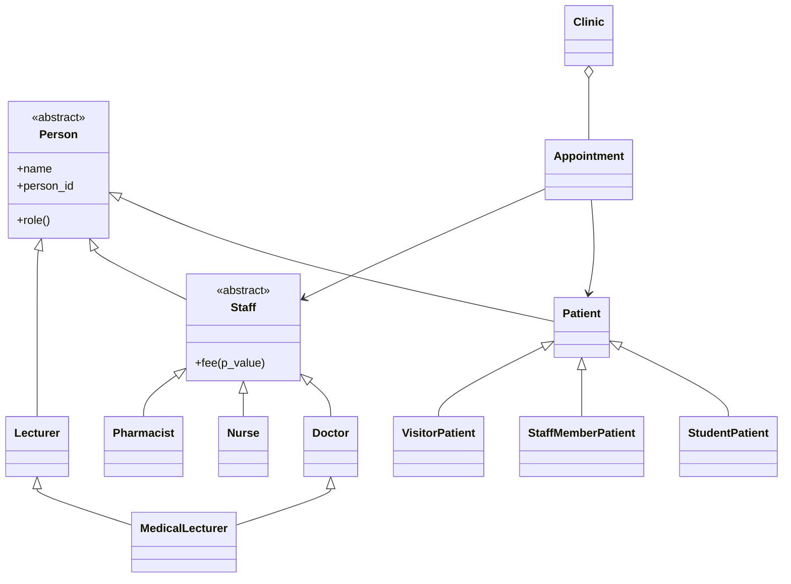
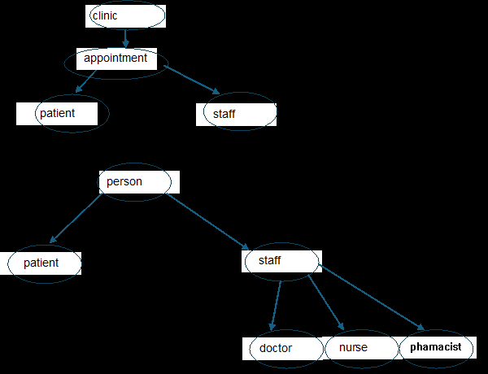

# Clinic Appointment System — implementation notes

## Run
From this folder:
```bash
python main.py
python -m unittest -v test_system.py
```

The project uses only the Python standard library.

## Class structure


## Assignment answers and design decisions

**P = 7.** Therefore `P mod 4 = 3`, so the twist is patient discounts.

**1. Abstraction and class responsibilities.** `Person` defines identity and the abstract `role()` contract. `Patient` and `Staff` specialise it. `Staff.fee()` is abstract so each staff role supplies its own fee. `Appointment` owns its lifecycle, while `Clinic` coordinates registration and booking.

**

**2. Encapsulation and invariants.** Identity fields are exposed through read-only properties. Clinic stores registries privately and returns tuples rather than its mutable dictionaries. Appointment status can only be changed through `confirm()` and `cancel()`. Cancelled appointments are terminal and no longer reserve a time slot.

**3. Polymorphic staff fees.** For P=7: Doctor = 40 + 5*(7 mod 5) = $50; Nurse = 10 + (7 mod 3) = $11; Pharmacist = $5. The staff loop calls `role()` and `fee()` on every staff object. It contains no type tests, so adding another Staff subclass does not require changing that loop.

**4. Logging.** `AppointmentLogger` is a context manager. `with` guarantees that `__exit__` is invoked when the block ends, including when an exception escapes. Each business action is journalled; rejected actions are also recorded. If writing the failure itself is impossible, the secondary logging error is reported to the console without hiding the original business error. A physical storage failure can prevent a successful close; software cannot guarantee an operating-system-level write.

**5. Multiple inheritance.** `MedicalLecturer` is both a `Doctor` and a `Lecturer`. Cooperative `super()` calls follow the method resolution order and reach `Person.__init__` once. Its fee uses the Doctor formula because the booked service is a medical consultation. The constructor counter demonstrates the single call. In Java, `Lecturer` would be modelled as an interface because Java classes cannot extend two classes.

**6. Patient discount twist.** `Patient.payment_factor()` is the pricing policy: student 0.5, staff-member 0.0, visitor 1.0. `Appointment.calculate_fee()` multiplies the staff fee by that factor. No `isinstance` or patient-type branching is needed.

### Design decision log

- **D1 — Cancellation rule location:** The two-hour rule lives in `Appointment.cancel()`, because it is a rule governing one appointment's valid state transition. The trade-off is that Appointment needs the current time as an argument; this is preferable to hiding a system-clock dependency inside the entity.
- **D2 — Clock strategy:** `ClinicClock` is injected into Clinic. Tests can set time deterministically, avoiding flaky tests and dependence on the machine clock.
- **D3 — Adding Pharmacist:** A `Pharmacist` class implements `fee()` and `role()`. The polymorphic loop and Clinic booking workflow do not need edits.
- **D4 — MedicalLecturer fee and identity:** It inherits Doctor's fee because the service is clinical. Cooperative multiple inheritance ensures one Person initialisation; the counter test verifies it.
- **D5 — Logging failures:** The context manager closes the stream on normal and exceptional exits. If a write fails, the same failed stream may not be able to record that failure, so the fallback reports it to stderr/console. A close failure is raised if there is no earlier exception; otherwise the original exception is preserved.
- **D6 — Discount ownership:** The patient subtype supplies a payment factor because eligibility belongs to the patient category. Appointment applies the factor to the staff fee. This separates policy from fee schedule and avoids conditional type checks.

## Demonstration outline (about five minutes)
1. Register three patient categories and four staff entries.
2. Show MedicalLecturer's module and the Person constructor count delta of one.
3. Run the polymorphic staff fee loop.
4. Book appointments, confirm one, and display the three discount outcomes.
5. Cancel an appointment and attempt a deliberate double booking to demonstrate rejection and failure logging.
6. Run the tests with `python -m unittest -v test_system.py`.
